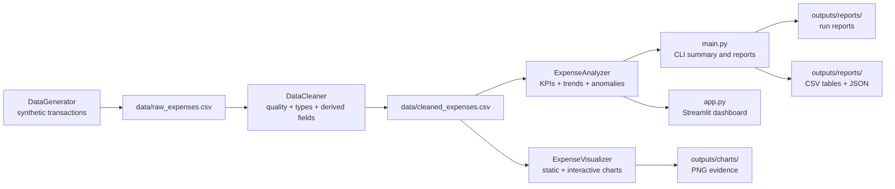

# Expense Tracker App using Data Science

A portfolio-ready Python project that turns expense records into a reproducible data pipeline, analysis outputs, visual evidence, and an interactive Streamlit dashboard.

> **Portfolio boundary:** This project uses **synthetic expense data** for learning and demonstration. Its generated amounts are not real-world financial facts, and the project is a portfolio/demo tool—not financial advice.

## Project at a glance

| Item | Description |
| --- | --- |
| Project type | End-to-end data analytics and dashboard portfolio project |
| Primary audience | Recruiters for Data Analyst, Business Analyst, and Financial Analyst roles |
| Default data | 600 synthetic transactions over an approximately 180-day window |
| Core language | Python 3.10+ |
| Selected approach | **Option B: Python data pipeline + Streamlit dashboard** |
| CLI contract | `python main.py` |
| Test contract | `python -m pytest` |
| Dashboard contract | `streamlit run app.py` |
| Reproducibility note | The random seed and default date window (2024-01-01 to 2024-06-30) are fixed |

## What this project does

### Simple explanation

Imagine a small personal or business ledger. The application creates or receives expense rows, organizes them into categories, checks whether the data is usable, calculates useful measures, and presents the result as charts and KPI cards. A user can answer:

- Where is most of the money going?
- How does spending change by month or day of week?
- Which payment methods are used most?
- Which transactions deserve a closer look?
- What evidence supports a spending recommendation?

### Technical explanation

This is a modular data-science workflow:

1. `src/data_generator.py` creates labeled synthetic records with dates, categories, amounts, descriptions, payment methods, tags, notes, and recurring flags.
2. `src/data_cleaner.py` checks missing values, removes duplicates, converts data types, validates amounts and dates, flags amount outliers, standardizes text, and adds date-derived fields.
3. `src/analyzer.py` calculates descriptive statistics, category/payment breakdowns, daily/weekly/monthly trends, recurring-spend summaries, percentile-based high/low spending, anomaly details, and correlations.
4. `src/visualizer.py` creates static chart files and interactive Plotly figures, including category, monthly, payment-method, distribution, heatmap, and day-of-week views.
5. `main.py` is the command-line entrypoint and `app.py` is the Streamlit presentation layer.
6. `data/` stores generated CSV inputs and cleaned data; `outputs/` stores reproducible reports, tables, and chart evidence. `tests/` protects deterministic generation, cleaning, analysis, visualization, and the end-to-end pipeline.

The layers are deliberately separate so each stage can be inspected in an interview or extended independently.

## Personal and business use cases

### Personal use cases

- Review totals by category such as Rent, Food & Dining, Transportation, Shopping, or Utilities.
- Compare monthly and daily spending patterns.
- Separate recurring from non-recurring transactions.
- Find unusually large transactions for manual review.
- Export a clean personal ledger for further analysis.

### Small-business and team use cases

- Summarize operating expenses by category or payment method.
- Create a repeatable monthly reporting workflow.
- Identify unusual transactions before a review meeting.
- Give a manager a dashboard instead of a raw CSV.
- Demonstrate how a lightweight analytics product could grow into a controlled expense-reporting system.

These are analytical use cases, not accounting, tax, investment, lending, or financial-advice services. A production finance tool would need permissions, audit history, validated source data, and stronger controls.

## Tech-stack options

| Option | Stack | Best for | Trade-off |
| --- | --- | --- | --- |
| Option A: notebook-first | Python, Pandas, NumPy, Matplotlib, Seaborn, Jupyter | Learning the pipeline and showing step-by-step analysis | Less convenient for a non-technical reviewer to explore |
| **Option B: portfolio dashboard (selected)** | **Python, Pandas, NumPy, CSV, Matplotlib, Seaborn, Plotly, Streamlit, pytest, Jupyter** | **A one-week placement/internship portfolio piece with analysis and product presentation** | **Local files and synthetic data; not a production finance platform** |
| Option C: production extension | Option B plus database, API, authentication, deployment, CI/CD, and a frontend | Multi-user or operational use | More infrastructure, security, and maintenance than this student project needs |

**Why Option B is selected:** it demonstrates data generation, cleaning, analysis, visualization, testing, and communication without hiding the logic behind a large framework. It is achievable, explainable in an interview, and easy to run locally. SQLite, live bank integrations, authentication, and machine-learning forecasting are future extensions rather than required current dependencies.

## Architecture and data flow

### Architecture diagram



The CLI writes analysis tables, JSON KPIs, and a text insight report to `outputs/reports/`. Only files created by an actual run should be described as results.

### End-to-end data flow

1. **Configure paths:** importing `src.config` defines project-root-relative `data/` and `outputs/` paths and creates configured runtime directories.
2. **Generate:** `DataGenerator(num_records=600)` creates synthetic rows using the configured seed and writes `data/raw_expenses.csv`.
3. **Clean:** `DataCleaner(filepath=RAW_DATA_PATH).clean_data()` checks missing values, deduplicates, converts types, validates ranges, flags category-relative outliers, standardizes text, and adds time, ratio, spending-level, weekend, and cumulative-month features.
4. **Analyze:** `ExpenseAnalyzer(data=cleaned_data).analyze_all()` calculates totals, averages, medians, category/payment summaries, time trends, recurring-spend views, percentiles, and anomaly details.
5. **Visualize:** `ExpenseVisualizer(cleaned_data).visualize_all()` writes static PNGs to `outputs/charts/`; Plotly methods provide interactive figures for the dashboard.
6. **Present and inspect:** the CLI summarizes the run, the dashboard exposes interactive views, and the notebooks show generation and cleaning decisions without committing executed output.

## Expected generated files

Generated artifacts are evidence of a run, not source code. Run from the repository root.

| Path | Created by / purpose |
| --- | --- |
| `data/raw_expenses.csv` | Original synthetic transactions from the generator |
| `data/cleaned_expenses.csv` | Cleaned, validated, enriched transaction table |
| `outputs/charts/01_category_pie_chart.png` | Category share chart |
| `outputs/charts/02_category_bar_chart.png` | Total spending by category |
| `outputs/charts/03_monthly_trend.png` | Monthly spending trend |
| `outputs/charts/04_daily_heatmap.png` | Day-of-week versus month heatmap |
| `outputs/charts/05_payment_distribution.png` | Payment-method totals and counts |
| `outputs/charts/06_amount_histogram.png` | Distribution of transaction amounts |
| `outputs/charts/07_day_of_week_analysis.png` | Total, count, and average by day of week |
| `outputs/reports/` | KPI JSON, cleaning JSON, insight text, and analysis CSV tables |

The exact totals, dates, and outlier counts must be read from the current run. Do not copy example numbers from an old guide into a portfolio claim.


## End-to-end workflow

1. Start in the project root and create/activate a Python 3.10+ virtual environment.
2. Install `requirements.txt` so the analysis, dashboard, notebook, and test tools share one environment.
3. Run the CLI contract: `python main.py`.
4. Inspect `data/raw_expenses.csv`, `data/cleaned_expenses.csv`, and generated `outputs/` artifacts.
5. Run tests with `python -m pytest`.
6. Open the dashboard with `streamlit run app.py` and capture the evidence listed below.
7. Use the notebooks to explain generation and cleaning decisions; do not present unexecuted cells as results.
8. Add only reviewed, non-sensitive evidence to GitHub and label every synthetic result clearly.


## Repository structure

```text
Expense-Tracker-App/
├── data/
│   ├── .gitkeep
│   ├── raw_expenses.csv              # generated synthetic input (runtime)
│   └── cleaned_expenses.csv          # generated cleaned/enriched data (runtime)
├── docs/
│   ├── DATA_DICTIONARY.md
│   ├── EXECUTION_AND_FINISHING.md
│   ├── INTERVIEW_PREPARATION.md
│   └── PROJECT_PLAN.md
├── images/
│   └── .gitkeep                      # add reviewed evidence screenshots here
├── notebooks/
│   ├── 01_data_generation.ipynb
│   └── 02_data_cleaning.ipynb
├── outputs/
│   ├── .gitkeep
│   ├── charts/
│   │   └── .gitkeep
│   └── reports/
│       └── .gitkeep
├── src/
│   ├── __init__.py
│   ├── analyzer.py
│   ├── config.py
│   ├── data_cleaner.py
│   ├── data_generator.py
│   └── visualizer.py
├── tests/
│   └── test_pipeline.py
├── app.py                            # Streamlit entrypoint contract
├── main.py                           # CLI entrypoint contract
├── requirements.txt
├── .gitignore
└── README.md
```

`tests/` lives at the repository root and is run with `python -m pytest`. Generated CSVs are ignored by default to keep the repository light; selected chart evidence can be tracked deliberately. The `.gitignore` leaves `outputs/` available for reviewed proof artifacts.

## Setup

### Prerequisites

- Python **3.10 or newer**
- Git
- A terminal with permission to create files in the project directory
- Optional: a browser for Streamlit

### Windows PowerShell

```powershell
# Clone and enter the repository (skip git clone if already downloaded)
git clone https://github.com/<your-username>/expense-tracker-app.git
Set-Location .\expense-tracker-app

py -3.10 -m venv .venv
.\.venv\Scripts\Activate.ps1

# If PowerShell blocks activation, allow it for this terminal only:
# Set-ExecutionPolicy -Scope Process -ExecutionPolicy Bypass

python -m pip install --upgrade pip
python -m pip install -r requirements.txt
```

Command Prompt activation is:

```bat
.venv\Scripts\activate.bat
```

### macOS

```bash
python3 --version
git clone https://github.com/<your-username>/expense-tracker-app.git
cd expense-tracker-app

python3 -m venv .venv
source .venv/bin/activate
python -m pip install --upgrade pip
python -m pip install -r requirements.txt
```

### Linux (Ubuntu/Debian)

```bash
sudo apt update
sudo apt install -y python3 python3-pip python3-venv git
python3 --version

git clone https://github.com/<your-username>/expense-tracker-app.git
cd expense-tracker-app

python3 -m venv .venv
source .venv/bin/activate
python -m pip install --upgrade pip
python -m pip install -r requirements.txt
```

### Verify the environment

Run from the project root with the environment active:

```bash
python --version
python -c "import pandas, numpy, matplotlib, seaborn, plotly, streamlit, pytest; print('Environment ready')"
python -m pip check
```

## Run commands and expected outputs

Run the three contract commands from the project root. These commands are intentionally exact so they can be copied into a placement submission, GitHub Actions job, or interview demo.

### 1. Command-line pipeline

```bash
python main.py
```

Expected behavior:

- The command starts the end-to-end CLI workflow.
- 600 synthetic records are generated with seed `42` over 2024-01-01 through 2024-06-30.
- Cleaning and analysis summaries are printed in the terminal.
- `data/raw_expenses.csv` and `data/cleaned_expenses.csv` are written.
- Eight PNG charts and report/table files are written below `outputs/`.

Do not paste invented totals into a README. Capture the actual terminal output from your run and label it as synthetic.

### 2. Tests

```bash
python -m pytest
```

Expected behavior:

- Pytest discovers the repository's tests and prints a pass/fail summary.
- The command uses the same virtual environment as the application.
- “No tests collected” means the test suite is not present; it is not evidence that the application passed.

### 3. Streamlit dashboard

```bash
streamlit run app.py
```

Expected behavior:

- Streamlit starts a local server, normally at `http://localhost:8501`.
- The browser shows KPI cards, filters, charts, and any download/report controls implemented by `app.py`.
- The dashboard identifies the data as synthetic and keeps currency/unit assumptions clear.

If the `streamlit` executable is not on `PATH`, use this diagnostic equivalent:

```bash
python -m streamlit run app.py
```

## Notebooks

The notebooks are explanatory, runnable walkthroughs with **no fabricated executed outputs** committed to GitHub.

Start Jupyter from the project root:

```bash
jupyter notebook notebooks/01_data_generation.ipynb
jupyter notebook notebooks/02_data_cleaning.ipynb
```

Or launch one server and open both notebooks:

```bash
jupyter notebook
```

Then open `notebooks/01_data_generation.ipynb` followed by `notebooks/02_data_cleaning.ipynb`. The first notebook uses the current `DataGenerator` and saves raw data. The second reads that raw file with the current `DataCleaner` signature, runs the cleaning pipeline, and saves the cleaned file. Run cells from top to bottom and save screenshots separately; keep notebook outputs empty in committed source unless an output is intentionally reviewed.

## Results, interpretation, and limitations

### What a good run demonstrates

- A complete path from generated rows to cleaned, analyzed, and visualized data.
- Transparent data-quality decisions rather than a black-box result.
- KPIs that can be explained to technical and non-technical reviewers.
- Static files that can be attached to a portfolio and an interactive dashboard for a live demo.
- A reproducible process that is safe to share because it has no personal financial records.

### Limitations to state in an interview

- The data is synthetic and generated from hand-written distributions; it does not represent a population or prove real consumer behavior.
- The default date range is fixed to 2024-01-01 through 2024-06-30, so it is not a historical financial record.
- Outliers are flagged with a category-relative z-score/IQR rule. A large purchase may be legitimate, and statistical unusualness is not fraud detection.
- No bank feed, authentication, accounting rules, tax treatment, currency conversion, or audit trail is included.
- The current analysis is descriptive. It does not forecast cash flow, recommend investments, or provide financial advice.
- Dashboard screenshots and result claims must come from an actual run of the current checkout.


## Exact screenshots and evidence to capture

Save reviewed screenshots under `images/` with descriptive names. Avoid screenshots containing personal paths, API keys, tokens, or real account data.

1. **`01_environment.png`** — terminal showing Python 3.10+ and successful dependency installation.
2. **`02_project_structure.png`** — repository root showing `src/`, `docs/`, `notebooks/`, `data/`, `outputs/`, and entrypoints.
3. **`03_raw_data_preview.png`** — first rows of `data/raw_expenses.csv`, shape, dtypes, and a visible synthetic-data label.
4. **`04_cleaning_evidence.png`** — notebook or CLI showing missing-value checks, duplicate handling, type conversion, and outlier policy.
5. **`05_cleaned_data_preview.png`** — cleaned rows with fields such as `Month`, `DayOfWeek`, and `Is_Outlier`.
6. **`06_cli_run.png`** — the completed `python main.py` terminal run with actual generated output paths.
7. **`07_chart_evidence.png`** — a contact sheet or selected PNGs from `outputs/charts/` with readable labels and units.
8. **`08_dashboard_overview.png`** — Streamlit page showing KPIs, synthetic-data disclaimer, and main charts.
9. **`09_dashboard_filter.png`** — one meaningful filter interaction and resulting visual/KPI change.
10. **`10_test_result.png`** — terminal showing the actual `python -m pytest` result.
11. **`11_github_repository.png`** — GitHub file tree, rendered README, topics, and recent commit history.

For every screenshot, keep a matching note: command or interaction, date captured, input file, and what the evidence proves.

## Troubleshooting

### `ModuleNotFoundError: No module named ...`

Confirm the environment is active and install through the active interpreter:

```bash
python --version
python -m pip install -r requirements.txt
python -m pip check
```

Avoid mixing `pip` from one Python installation with `python` from another.

### An entrypoint cannot be found

Run from the project root and verify the files:

```bash
# macOS/Linux
pwd
ls main.py app.py

# Windows PowerShell
Get-Location
Get-ChildItem main.py, app.py
```

### `FileNotFoundError` for `data/raw_expenses.csv`

The generator must run before a consumer reads the raw file. Use the CLI contract first. For a module-level diagnostic:

```bash
python -m src.data_generator
python -c "from pathlib import Path; print(Path('data/raw_expenses.csv').exists())"
```

### `pytest` reports no tests collected

`python -m pytest` is the required command, but “no tests collected” means there is no discoverable `tests/` suite. Add meaningful tests before calling the project verified; do not turn an empty collection into a false green result.

### Streamlit is not found or the port is busy

Use the interpreter-bound command and, if needed, a different port:

```bash
python -m streamlit run app.py
streamlit run app.py --server.port 8502
```

### PowerShell refuses to activate `.venv`

Use a process-scoped policy change:

```powershell
Set-ExecutionPolicy -Scope Process -ExecutionPolicy Bypass
.\.venv\Scripts\Activate.ps1
```

### Notebook imports fail

Start Jupyter from the project root, not from inside `notebooks/`:

```bash
jupyter notebook
```

Restart the kernel after installing requirements, then run cells from top to bottom.

### Generated files look stale

Delete only generated files you can recreate, reactivate the environment, and rerun the pipeline. Do not delete source, documentation, or evidence without checking Git status. The default date window is fixed for reproducible screenshots.

## Interview quick preparation

### HR/project explanation

> “I built an Expense Tracker App using Data Science as a portfolio project. It takes synthetic expense records through a complete workflow: generation, cleaning, analysis, visualization, and dashboard presentation. I chose synthetic data because financial records are sensitive and I wanted a reproducible, safe project that recruiters can run. The project shows how I turn an ambiguous question—where and when are expenses concentrated?—into a transparent pipeline with documented assumptions. It is a demonstration tool, not financial advice.”

### Technical project explanation

> “The project is a modular Python pipeline. `DataGenerator` creates 600 controlled synthetic records. `DataCleaner` checks missing values and duplicates, converts types, validates amounts and dates, flags outliers, standardizes text, and adds time features. `ExpenseAnalyzer` produces descriptive, categorical, payment, temporal, recurring, percentile, and anomaly insights. `ExpenseVisualizer` creates static Matplotlib/Seaborn charts and Plotly figures for the Streamlit layer. The CLI and dashboard expose the same analysis flow, while `pytest` protects important boundaries.”


## Future improvements

- Build a **mobile app** with React Native or Flutter for quick expense entry.
- Add **real-time tracking** through a consent-based bank or payment-provider
  integration with authentication, retries, and an audit trail.
- Add **AI-based spending prediction** only after establishing time-aware
  baselines, leakage-safe evaluation, uncertainty intervals, and human review.
- Add **budgeting alerts** for user-defined monthly/category limits rather than
  relying on the current educational baseline.
- Add **financial goal tracking** for savings targets, progress-to-goal views,
  and scenario planning; keep the tool educational rather than advisory.
- Add an explicit data dictionary and schema validation at the input boundary.
- Support user-uploaded CSVs with consent, column mapping, currency, and timezone handling.
- Add budgets, period-over-period comparisons, recurring-subscription review, and export controls.
- Store multi-user data in a database with authentication, permissions, audit history, and backups.
- Add tested, time-aware forecasting and explainable anomaly ranking; compare ML models against simple baselines.
- Add CI for `python -m pytest`, dependency checks, notebook smoke tests, and dashboard health checks.
- Deploy the Streamlit app only after reviewing privacy and documenting the synthetic/demo boundary.
- Improve accessibility with color-safe palettes, text alternatives, keyboard navigation, and downloadable tables.

---

**One-line portfolio summary:** A reproducible Python data pipeline and Streamlit dashboard that demonstrates synthetic-data generation, cleaning, exploratory analysis, KPI design, anomaly flagging, visualization, testing, and clear communication.

## Author
*Sanchita Giri* — 3rd Year CSE Student, Jawaharlal Darda Institute of Engineering & Technology, Yavatmal  
[LinkedIn](linkedin.com/in/sanchita-vijay-giri-28563b3b0) 
